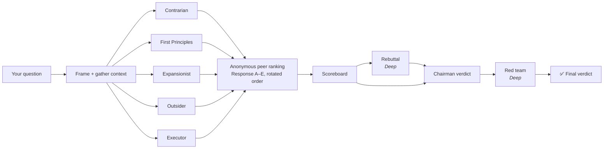

<div align="center">

# 🏛️ LLM Council

### Stop trusting one AI answer. Convene a council.

**A decision-making skill for Claude and every other LLM.** Your question goes to independent advisors who each think differently. They anonymously rank and tear apart each other's answers, and a chairman delivers a verdict you can act on.

[](LICENSE)
[](SKILL.md)
[](#-install)
[](scripts/council.py)

*Inspired by [Andrej Karpathy's LLM Council](https://github.com/karpathy/llm-council).*

</div>

---

## Why

You ask one AI a question and get one answer. Maybe it's great. Maybe it's mid. **You can't tell, because you only saw one perspective**, and LLMs tend to agree with whoever's asking.

The council fixes that the way good boards and investment committees do: **independent opinions first, anonymous critique second, a committed decision last.**

```
You: "council this: should I quit my job to go full-time on my SaaS at $4k MRR?"
```

```
## Council Verdict: Quit job for SaaS at $4k MRR
*Standard council · 5 seats · sub-agents*

Bottom line: Not yet. Set a dated tripwire of $8k MRR or 6 months instead of quitting now.
Confidence: Medium, the crux is churn, and nobody has that number. · Decision type: One-way door

Where the Council Agrees · Where the Council Clashes (+ the crux) · Blind Spots Caught
The Recommendation · What Would Change This Verdict · The One Thing to Do First
+ Scoreboard: each advisor's position, confidence, and anonymous peer rank
```

---

## ✨ What makes it different

| | Single AI answer | Original council skill | **LLM Council (this repo)** |
|---|:-:|:-:|:-:|
| Multiple independent perspectives | ❌ | ✅ | ✅ |
| Anonymous peer review | ❌ | ✅ | ✅ **full ranking + rotated order**, which cancels positional bias |
| Aggregated peer **scoreboard** | ❌ | ❌ | ✅ Karpathy-style average rank |
| Structured advisor output (position, confidence, weakest assumption, what would change my mind) | ❌ | ❌ | ✅ |
| **Quick / Standard / Deep** modes | ❌ | ❌ | ✅ |
| Specialist seats (Domain Expert, Stakeholder, Historian, Pre-Mortem) | ❌ | ❌ | ✅ |
| **Rebuttal round** (advisors HOLD or UPDATE) | ❌ | ❌ | ✅ |
| **Red team** attacks the verdict before you see it | ❌ | ❌ | ✅ |
| Calibrated confidence + one-way/two-way door | ❌ | ❌ | ✅ |
| **Tripwires**: what would prove the verdict wrong | ❌ | ❌ | ✅ |
| Anti-sycophancy and anti-fabrication rules | ❌ | partial | ✅ |
| Works without sub-agents (ChatGPT, Gemini…) | n/a | ❌ | ✅ sealed-rounds protocol |
| **Real multi-model** council (GPT + Claude + Gemini + local) | ❌ | ❌ | ✅ `scripts/council.py` |

---

## 🧠 How it works



### The seats

| Seat | Thinks like | Tension |
|---|---|---|
| 🔴 **The Contrarian** | "There's a fatal flaw. Let me find it." | ↔ Expansionist |
| 🔵 **The First Principles Thinker** | "What are we *actually* solving? Maybe the wrong question." | ↔ Executor |
| 🟢 **The Expansionist** | "What if this works 10x better? What's the hidden upside?" | ↔ Contrarian |
| ⚪ **The Outsider** | "I have zero context, and I don't understand this." | keeps everyone honest |
| 🟠 **The Executor** | "OK, but what happens Monday morning?" | ↔ First Principles |
| *Deep:* 🎓 Domain Expert · 👤 Stakeholder · 📜 Historian · ⚰️ Pre-Mortem | field knowledge · affected party · base rates · failure story | |

### The modes

| Mode | Say | Seats | Rounds | Calls |
|---|---|---|---|---|
| ⚡ **Quick** | "quick council" | 3 | answers → chairman | 4 |
| 🏛️ **Standard** | "council this" | 5 | answers → peer ranking → chairman | 11 |
| 🔥 **Deep / War Room** | "deep council", "war room this" | 7 | answers → ranking → rebuttal → chairman → red team | 23 |

---

## 📦 Install

### Claude Code (recommended: full parallel sub-agents)

**macOS / Linux**
```bash
git clone https://github.com/Pawan028/llm-council.git ~/.claude/skills/llm-council
```

**Windows (PowerShell)**
```powershell
git clone https://github.com/Pawan028/llm-council.git "$env:USERPROFILE\.claude\skills\llm-council"
```

For a single project instead, clone into `<your-project>/.claude/skills/llm-council`. Restart Claude Code and say **"council this: …"**.

### Claude.ai / Claude Desktop
[Download the ZIP](https://github.com/Pawan028/llm-council/archive/refs/heads/main.zip), then upload it in the **Skills** section of your Claude settings (Settings → Capabilities → Skills). Say **"council this: …"** in any chat.

### Claude Agent SDK
Put the folder in `.claude/skills/llm-council/` in your agent's working directory and enable skills in your SDK options.

### ChatGPT · Gemini · Grok · Copilot · DeepSeek · any chatbot
Copy the prompt in **[`adapters/universal-prompt.md`](adapters/universal-prompt.md)** into:
- **ChatGPT:** Custom Instructions, a Custom GPT, or a Project
- **Gemini:** a Gem
- **Anything else:** the system prompt, or paste it at the top of a chat

### Codex CLI · Gemini CLI · GitHub Copilot · Windsurf · Aider · Cline · OpenCode
Append **[`adapters/AGENTS.md`](adapters/AGENTS.md)** to your project's `AGENTS.md` / `GEMINI.md` / `.github/copilot-instructions.md` / `.windsurfrules` / `CONVENTIONS.md`.

### Cursor
```bash
mkdir -p .cursor/rules && cp adapters/cursor/llm-council.mdc .cursor/rules/
```

---

## 🌐 True multi-model council (Karpathy-style)

A council of *different models* catches blind spots that one model playing five roles can't. [`scripts/council.py`](scripts/council.py) gives every seat a different model, runs the anonymous ranking across models, and has a chairman model write the verdict.

- **Zero dependencies:** Python 3.8+ standard library
- **Any OpenAI-compatible API:** OpenRouter (one key → OpenAI, Anthropic, Google, Meta, Mistral, DeepSeek…), OpenAI, Groq, Together, **Ollama**, LM Studio, vLLM
- Parallel calls, retries, a scoreboard, and saved transcripts

```bash
# One key, many vendors via OpenRouter
export COUNCIL_API_KEY=sk-or-...
python scripts/council.py "Should I raise a seed round or stay bootstrapped at \$20k MRR?" \
  --models openai/gpt-5 anthropic/claude-sonnet-5 google/gemini-2.5-pro \
  --chairman anthropic/claude-opus-5-5 \
  --mode deep

# 100% local and free with Ollama
python scripts/council.py "Rewrite our monolith or keep patching it?" \
  --base-url http://localhost:11434/v1 --models llama3.1 qwen2.5 mistral

# Feed it context files
python scripts/council.py --question-file decision.md --context metrics.csv plan.md --models ...

# Try the pipeline offline (no API calls)
python scripts/council.py "test" --mock --mode deep
```

> Model slugs are examples. Use whatever your provider currently lists.
> Env vars: `COUNCIL_API_KEY` (or `OPENROUTER_API_KEY` / `OPENAI_API_KEY`), `COUNCIL_MODELS=m1,m2,m3`, `COUNCIL_CHAIRMAN`, `COUNCIL_BASE_URL`, `COUNCIL_MODE`.
> Transcripts are saved to `./council-transcripts/` (disable with `--out ""`). Use `--json` for raw output.

---

## 💬 Usage

**Triggers:** `council this` · `run the council` · `war room this` · `pressure-test this` · `stress-test this` · `debate this` · `quick council` · `deep council`. Real dilemmas like *"should I X or Y"* or *"I'm torn between…"* also trigger it.

**Great council questions**
- "Should I launch a $97 workshop or a $497 course?"
- "Which of these 3 positioning angles is strongest?" *(paste them)*
- "Here's my landing page copy. What's weak?" *(you get before → after rewrites)*
- "Postgres or DynamoDB for this workload?" *(it reads your repo for context)*
- "I'm thinking of pivoting from agency to SaaS. Am I crazy?"

**Not council questions:** factual lookups, "write me a tweet", "summarize this". For those, the skill stays out of the way.

**Follow-ups:** *"dig into the pricing clash"* re-convenes only the relevant seats. *"I disagree because…"* makes the chairman re-weigh the new evidence (without caving just because you pushed back).

See a full run in **[`examples/`](examples/)**.

---

## 🛡️ Design principles

1. **Independence before discussion.** Advisors never see each other in round 1 (real parallel sub-agents or models, not one voice in five hats).
2. **Anonymous, order-rotated peer ranking.** Arguments win on merit, not on who made them or where they appear in the list.
3. **No fabrication.** Unknowns become labeled assumptions. If the verdict hinges on a checkable fact, the first step is usually to check it.
4. **No sycophancy.** Your enthusiasm isn't evidence. If you only want validation, you'll hear things you don't want to hear. That's the point.
5. **Commit.** No "it depends" without the crux *and* a direction. The chairman can overrule the majority.
6. **Falsifiable.** Every verdict ships with tripwires that would prove it wrong.
7. **One next step.** Not ten.

---

## 📁 Repo structure

```
llm-council/
├── SKILL.md                     # The skill (Claude Code / Claude.ai / Agent SDK)
├── references/
│   ├── advisors.md              # Full lens text for every seat
│   ├── prompts.md               # Advisor, reviewer, rebuttal, chairman, red-team prompts
│   └── output-format.md         # Verdict + transcript templates
├── adapters/
│   ├── universal-prompt.md      # ChatGPT, Gemini, Grok, any chatbot
│   ├── AGENTS.md                # Codex, Gemini CLI, Copilot, Windsurf, Aider…
│   └── cursor/llm-council.mdc   # Cursor rule
├── scripts/
│   └── council.py               # True multi-model council (zero deps)
└── examples/
    └── monolith-vs-microservices.md
```

---

## ❓ FAQ

**Isn't this just asking the same model five times?**
No. Each seat gets a deliberately opposed lens, and in Claude Code each one runs as an isolated sub-agent with a fresh context. The peer-ranking round is where the value compounds: it surfaces blind spots no single answer contains. For maximum diversity, use `council.py` with different vendors.

**How much does it cost?**
Standard is about 11 model calls and Deep about 23. Use `quick council` for everyday calls and save Deep for decisions that are expensive to get wrong.

**Can I add my own advisors?**
Yes. Add a lens to `references/advisors.md` (and to `SEATS` in `council.py`) and reference it in `SKILL.md`. PRs with great seats are welcome.

**Does it work offline?**
Yes, with Ollama or LM Studio through `council.py`.

**Is it a replacement for a lawyer, doctor, or financial advisor?**
No. For medical, legal, tax, or safety decisions, the council structures your thinking and tells you exactly who to consult.

---

## 🤝 Contributing

Issues and PRs are welcome, especially:
- new specialist seats and adapters for more tools
- better aggregation (e.g., Borda / Elo across multiple runs)
- real example transcripts (anonymized)

## 🙏 Credits

- [Andrej Karpathy](https://github.com/karpathy/llm-council) for the original LLM Council: answer → anonymous peer ranking → chairman.
- The original "LLM Council" Claude skill that introduced the five thinking-style advisors.

## 📄 License

[MIT](LICENSE). Use it, fork it, ship it.

<div align="center">

**If the council saved you from a bad call, ⭐ the repo so others can find it.**

</div>
